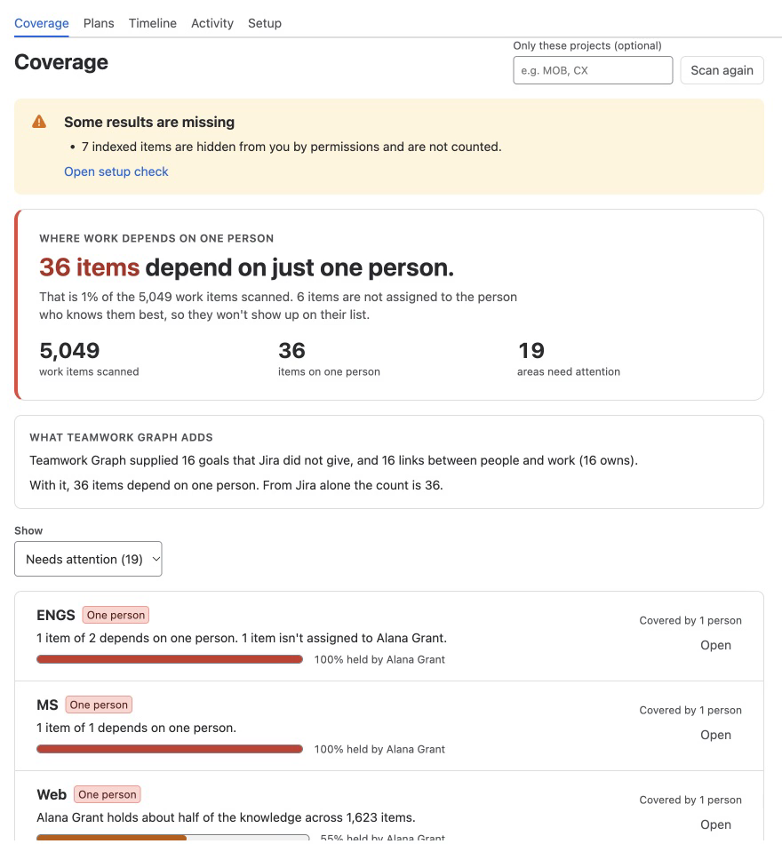
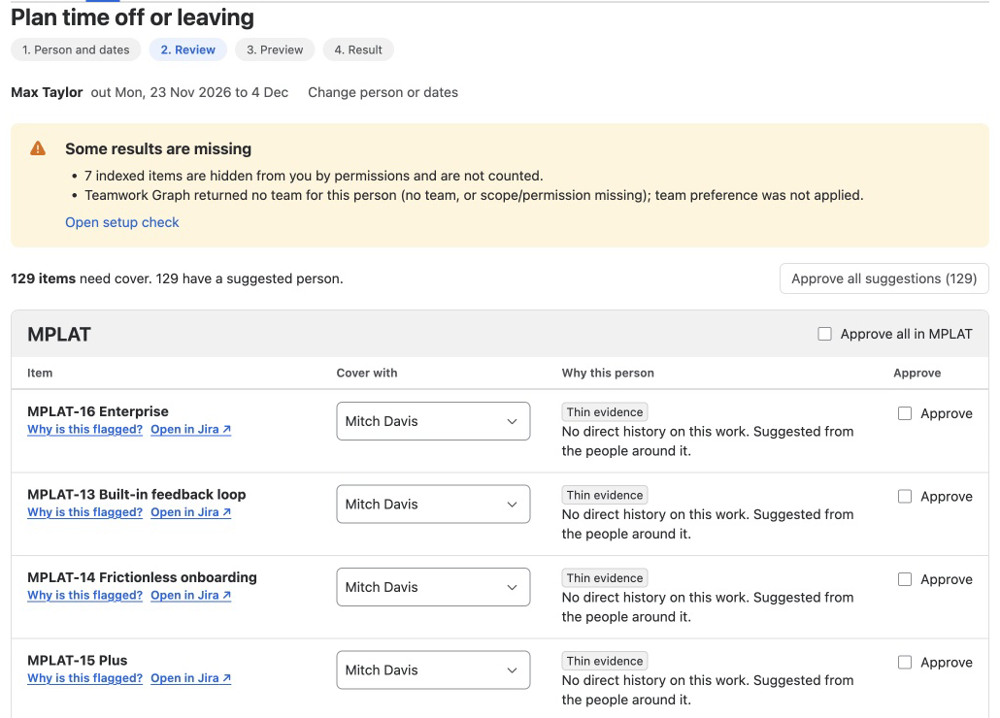
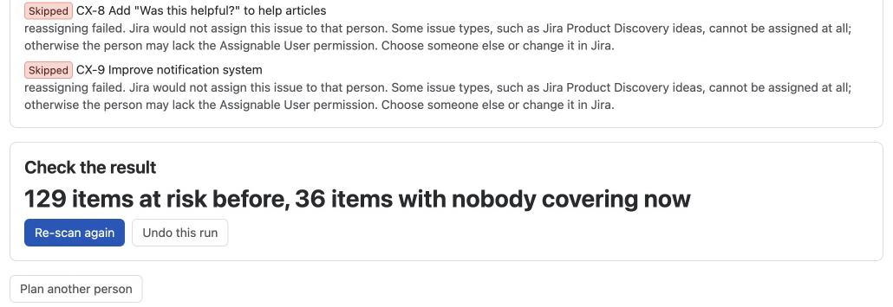

# Depth Chart

A Jira app that finds the work only one person knows, and helps you hand it over before they're away.

[Watch the 3-minute demo](https://youtu.be/IGHZt2qwpzg) · [Install on Jira Cloud](#try-it)

## The problem

Max is going on leave for two weeks from Monday. In Jira, some of the tickets he's been answering for months are assigned to other people, so nothing on his list warns you about them. And on some tickets he's the only person who has ever commented, so nobody else knows the background.

You usually find this out after he's gone, when a customer question sits unanswered and nobody knows why.

Depth Chart finds that work before he leaves. It looks at who actually commented on, was assigned to and wrote each ticket, not just who the assignee is today.

## What it does

1. Shows where work depends on one person. The Coverage page lists the areas and tickets where one person holds almost all the history, with the reason in plain words, like "Only Alana Grant has commented here (4 of 4 comments)".

   

2. Plans cover for a leave. Pick a person and their dates. The app lists every ticket that needs cover and suggests who should take each one, with the reason. When there isn't much history to go on, it says "Thin evidence" instead of pretending. You can swap any suggestion and set a limit on how many tickets one person gets.

   

3. Applies it after you approve. Nothing changes in Jira until you click approve. Then it reassigns the tickets, leaves a handover comment and adds watchers. If Jira refuses a change (for example, Jira Product Discovery ideas can't be assigned), the app lists it with the reason instead of hiding it.

4. Checks what's left. A re-scan shows how many tickets still have nobody covering them. In the demo, 129 tickets needed cover, 93 were handed over, and the 36 left were exactly the ones Jira refused.

   

5. Undoes the whole run in one click if you got it wrong. Every change is logged in Activity.

It also shows up in other places you already work:

- On the ticket. A "Who knows this" panel on each Jira issue warns you when the ticket depends on one person.
- On a timeline. Add several people's leave and see the weeks where a ticket has nobody left who knows it.
- In Rovo. Ask the Depth Chart agent "What breaks if Max is out for two weeks?" and it answers from the same data, with names and reasons. It only reads. Changes happen in the app, after a person approves.
- Through MCP. Assistants outside Atlassian, like Claude Code, can call the same four read-only tools.

## Try it

1. Install it on a Jira Cloud site with [this install link](https://developer.atlassian.com/console/install/0bdff584-47d8-4553-9367-624e76aac29b?signature=AYABeFZ2zNuDic47rYiIrVJuE%2BgAAAADAAdhd3Mta21zAEthcm46YXdzOmttczp1cy13ZXN0LTI6NzA5NTg3ODM1MjQzOmtleS83MDVlZDY3MC1mNTdjLTQxYjUtOWY5Yi1lM2YyZGNjMTQ2ZTcAuAECAQB4CxqLTo9l4lqXuFjNim1xJM%2Bp%2F3TVP9xHS2BrU5DRRucBru9W%2FsvCFla0v9ZrPKb7igAAAH4wfAYJKoZIhvcNAQcGoG8wbQIBADBoBgkqhkiG9w0BBwEwHgYJYIZIAWUDBAEuMBEEDHK17Wchm4PXhB2I5QIBEIA7IDjBY2lGW8naEXvLUowda4DwhNwSUP6%2Fm4Qe0bdtj2RrqwGaPVxLv1DoRLzUw%2Fe8HQyDSMU6hnp1xQ8AB2F3cy1rbXMAS2Fybjphd3M6a21zOmV1LXdlc3QtMTo3MDk1ODc4MzUyNDM6a2V5LzQ2MzBjZTZiLTAwYzMtNGRlMi04NzdiLTYyN2UyMDYwZTVjYwC4AQICAHi9bVMAkme4qVQX1fQHo6ePw3H40A7cGfz7yrmSfBWMXgFxX%2BB8of7Az8nRLnhy%2BSB2AAAAfjB8BgkqhkiG9w0BBwagbzBtAgEAMGgGCSqGSIb3DQEHATAeBglghkgBZQMEAS4wEQQMy%2F6UkZ%2FpjD27VvgHAgEQgDvdbXAt6i3oeVKTW4q5bDVVxdmlB%2FbNpjpN0FJ1hWkwokqH3WflBEL2uwgYIglPs0d4G00EwoS8npxagwAHYXdzLWttcwBLYXJuOmF3czprbXM6dXMtZWFzdC0xOjcwOTU4NzgzNTI0MzprZXkvNmMxMjBiYTAtNGNkNS00OTg1LWI4MmUtNDBhMDQ5NTJjYzU3ALgBAgIAeDYASx0XCjkny4iLV6vz%2BKtEGSGT6kdt0QRpkn6D%2FlVEAYXgrX3qkC3wQ6V53Ert3I8AAAB%2BMHwGCSqGSIb3DQEHBqBvMG0CAQAwaAYJKoZIhvcNAQcBMB4GCWCGSAFlAwQBLjARBAx4LdE1Az18ZKFgZ%2FoCARCAO6d25jfHNa%2FhRnuvqrM%2F66mp%2F6IlEQ%2FVMsVvZe%2FIoeLZW7vbUzNbYHfXkLnRgxxYLn57iviFrSKqZw%2FeAgAAAAAMAAAQAAAAAAAAAAAAAAAAAP3roJgTbITaOkbdmtqbVzL%2F%2F%2F%2F%2FAAAAAQAAAAAAAAAAAAAAAQAAADJiKbxsccnN2vHkhcoN%2BNy%2BZFXsSMCWqTGPtDHPQHtrwPyor2QtA3yR0L3C2X4qaQFWV2%2Bf3mp4Pb4ZGg0Eba5wp6Q%3D&product=jira).
2. Open Depth Chart from the Apps menu in Jira.
3. Click Explore the example company. It loads a sample company so you can try the whole flow in a few seconds, without touching your own site.
4. To use your own data, click Scan this site. On a big site, type a few project keys (like `MOB, CX`) to start small. Keep the page open while it scans.

The install link installs a copy of the app with the same code. Atlassian turns install links off once an app is listed on the Marketplace, and the Marketplace listing is in review.

To use the MCP tools, a site admin turns on "Expose tools to MCP-compatible apps" for the app under Site settings, Connected apps. Then connect a client to `https://mcp.atlassian.com/forge/0bdff584-47d8-4553-9367-624e76aac29b` and sign in. The four tools are `find-single-points`, `at-risk-for-person`, `suggest-successor` and `handover-brief`. [docs/mcp-skill.md](docs/mcp-skill.md) tells an assistant when to use each one.

## How it decides

There's no AI in the scoring. It counts.

For each ticket, the app adds up who commented, who was assigned and who wrote it, plus links from Teamwork Graph (goals and owners) where your site has them. A ticket counts as depending on one person when it has at least three recorded contributions and one person holds 80% or more of them.

To suggest cover, it looks at who has worked near that ticket: the same area, linked tickets, the same people. It ranks them, then spreads the work so nobody gets more than the limit you set.

Each flagged ticket has a "Why is this flagged?" link that shows the counts behind it. The Rovo agent uses Rovo to write its answers, but it reads the same counts.

## Does it hold up on real data?

I tested the idea on five public Apache projects in Jira (Spark, Cassandra, Hive, Ignite and Beam), writing down the rules before running the test.

- When someone left a project, 93% of the tickets they knew best weren't assigned to them (1,416 cases). So the assignee field misses most of this work. One caveat: the assignee is read today, after people left. Without the biggest project, Beam, it's 76%.
- I also expected the score to predict which tickets get ignored after someone leaves. It pointed the right way, but a plain comment count did slightly better. So the app doesn't claim to predict anything.
- The suggested person was the one who really picked up the work, within the top three, 42% of the time (518 cases). A random pick gets 2%. But "whoever commented most on that ticket" gets 41%, so the suggestions aren't clearly better than that simple rule.

The full method and results are in [backtest/RESULTS.md](backtest/RESULTS.md) and [backtest/RESULTS_SUCCESSOR.md](backtest/RESULTS_SUCCESSOR.md).

## Limits

- It only sees what's in Jira and Teamwork Graph. Knowledge that lives in someone's head or in chat is invisible to it.
- Scans are slow on big sites and need the page open. Forge's background queue returned errors on my test site, so scans run from the page instead.
- Teamwork Graph is in preview and answers as the person viewing, so some results can be missing records only someone else can see. The app marks those results as incomplete.
- Jira only. A Forge app that needs both Jira and Confluence can only be listed on the Marketplace as a paid app, and this one is free.

## What's in this repo

| Folder | What it is |
|---|---|
| `engine/` | The scoring, in plain TypeScript with no Forge code, so it runs the same in the app and in the backtest. 64 tests. |
| `app/` | The Forge app: scan, plans, apply and undo, the ticket panel, the Rovo agent and the MCP tools. The UI is in `app/static/hub`. 112 tests. |
| `backtest/` | The Apache test: rules written before the run, the scripts, and the results. |
| `docs/` | Privacy policy, support page and the MCP guide for assistants. |

Everything runs on Atlassian's own infrastructure (Forge). Data stays in Forge storage, and the app makes no calls outside Atlassian.

### Run it yourself

Needs Node 22 and the Forge CLI.

```
cd engine && npm install && npm test
cd ../app && npm install && npm test
cd static/hub && npm install && npm run build
cd ../.. && forge register && forge deploy && forge install
```

The example company is built from public Apache Kafka issue data, with people replaced by made-up names and comment text removed. Apache Kafka is a trademark of the Apache Software Foundation, and this project isn't endorsed by the ASF.
